

  <a href="https://ritikthakur.com.np">
    <picture>
      <source media="(prefers-color-scheme: dark)" srcset="assets/banner.svg" />
      <source media="(prefers-color-scheme: light)" srcset="assets/banner-light.svg" />
      
    </picture>
  </a>

    

  
  
  

 

## About me

I build and ship web, Android and cross-platform apps. I'm a Computer Engineering student who writes React frontends and backend APIs in a professional team, and I've published Android apps to Google Play alongside my own products.


- 💼 **Software Developer Intern** at Baudhika Learning (Sep 2026 – present): React features, backend APIs, React Native and Google Play releases.
- 🎓 **Bachelor of Computer Engineering** at ACEM, Tribhuvan University.
- 📱 **3 apps live on Google Play** and 5 shipped projects since 2025.
- 🧠 Exploring applied AI: LLM APIs, local models, RAG and AI coding agents.
- 🐧 Linux, VPS self-hosting, Android kernels and end-to-end encryption.
- 📍 Nepal · open to remote freelance and full-time roles.

## Tech stack

  

## Live on Google Play

  
    
  <table>
    <tr>
      <td align="center" width="33%">
        <a href="https://play.google.com/store/apps/details?id=com.eskool.crdy"></a>
          
        
      </td>
      <td align="center" width="33%">
        <a href="https://play.google.com/store/apps/details?id=com.crdy.fastshare"></a>
          
        
         
        <a href="https://fastshare.ritikthakur.com.np">Web app</a> · <a href="https://github.com/ritikthakur22/FastShare">Source</a>
      </td>
      <td align="center" width="33%">
        <a href="https://play.google.com/store/apps/details?id=com.ritikqrscanner.app"></a>
          
        
         
        <a href="https://github.com/ritikthakur22/com.ritikqrscanner.app">Source</a>
      </td>
    </tr>
  </table>

## Featured projects

  <table>
    <tr>
      <td align="center" width="33%">
        <a href="https://github.com/ritikthakur22/battery-info_app">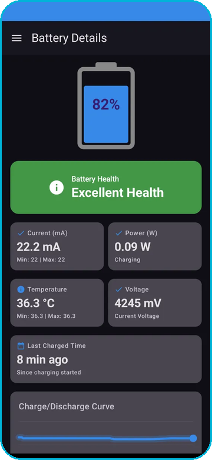</a>
        <h3>PowerGyan</h3>
        Battery analytics, alerts and widgets, plus root charge limiting
          
        <code>Kotlin</code> <code>Magisk</code> <code>KernelSU</code>
          
        <a href="https://github.com/ritikthakur22/battery-info_app/releases">Download</a> · <a href="https://github.com/ritikthakur22/battery-info_app">Source</a>
      </td>
      <td align="center" width="33%">
        <a href="https://github.com/ritikthakur22/scientific-calcr-pro">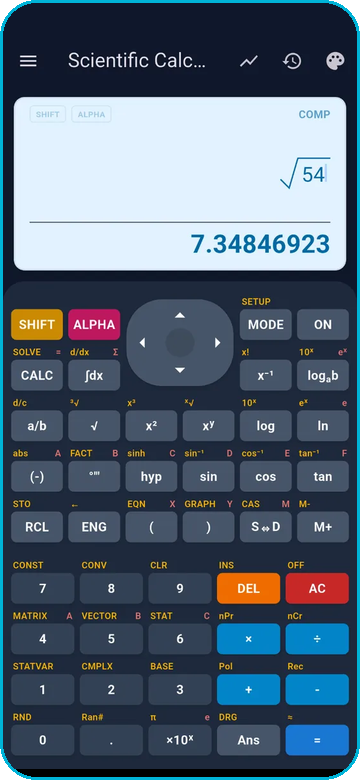</a>
        <h3>Scientific CalcR Pro</h3>
        Graphing, equation solving, matrices, vectors and statistics
          
        <code>Flutter</code> <code>Riverpod</code> <code>fl_chart</code>
          
        <a href="https://github.com/ritikthakur22/scientific-calcr-pro/releases/latest">Download APK</a> · <a href="https://github.com/ritikthakur22/scientific-calcr-pro">Source</a>
      </td>
      <td align="center" width="33%">
        <a href="https://github.com/ritikthakur22/RTCalc">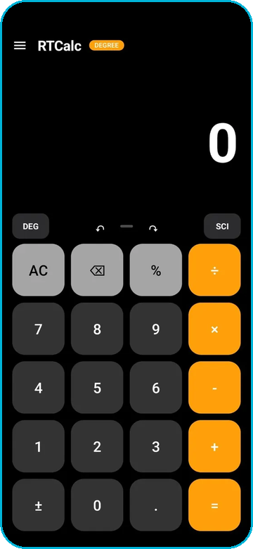</a>
        <h3>RTCalc</h3>
        Scientific calculator with history and a live NPR currency converter
          
        <code>Kotlin</code> <code>Android</code>
          
        <a href="https://github.com/ritikthakur22/RTCalc">Source</a>
      </td>
    </tr>
  </table>

## More projects

| Project | What it does | Built with |
| --- | --- | --- |
| [**Portfolio**](https://github.com/ritikthakur22/portfolio) · [live](https://ritikthakur.com.np) | My site, with motion design and an AI assistant that answers questions about my work | Next.js · GSAP · Vercel AI SDK |
| [**Todo v2**](https://github.com/ritikthakur22/Todo) · [demo](https://todocrdy.vercel.app) | Real-time collaborative tasks with Nepali dates | React · Node.js · Socket.io |
| [**Wi-Fi Analyzer**](https://github.com/ritikthakur22/wifi_analyzer_app) | Network details, signal graphs and LAN device discovery | Kotlin · Compose |
| [**Echo Loop**](https://github.com/ritikthakur22/Echo_Loop) · [demo](https://echo-loop-rho.vercel.app) | Delayed auditory feedback app for web and Android | React · Capacitor |
| [**FaceTrack**](https://github.com/ritikthakur22/attendance_using_face) | Face-recognition attendance with CSV and Excel reports | Python · Flask · OpenCV |
| [**Voice Mail**](https://github.com/ritikthakur22/voice_based_email) | Webmail you can use entirely by voice | FastAPI · faster-whisper |
| [**Daffodils School Site**](https://github.com/ritikthakur22/dps-site) | School website with a no-code admin panel | Next.js · Neon · Cloudinary |
| [**Morphe Patches**](https://github.com/ritikthakur22/morphe-patches) | Patches for modifying Android apps | Java · Android |

## Portfolio in motion

  <a href="https://ritikthakur.com.np">
    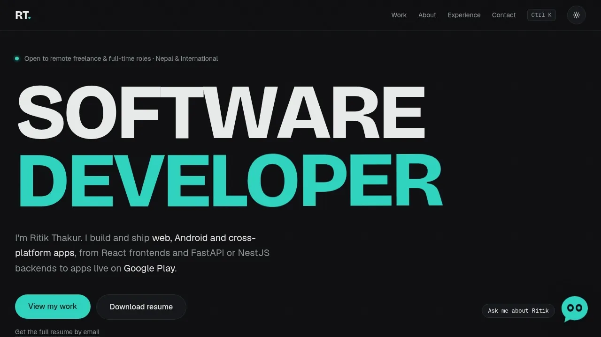
  </a>
   
  <a href="https://ritikthakur.com.np"><b>Visit ritikthakur.com.np →</b></a>

## Ask my assistant

  <a href="https://ritikthakur.com.np"></a>
   
  A preview, since GitHub can't run a chatbot. Chat with the real assistant on <a href="https://ritikthakur.com.np">ritikthakur.com.np</a>.

## GitHub activity

  <picture>
    <source media="(prefers-color-scheme: dark)" srcset="https://raw.githubusercontent.com/ritikthakur22/ritikthakur22/output/activity-dark.svg" />
    <source media="(prefers-color-scheme: light)" srcset="https://raw.githubusercontent.com/ritikthakur22/ritikthakur22/output/activity-light.svg" />
    
  </picture>
    
  <picture>
    <source media="(prefers-color-scheme: dark)" srcset="https://raw.githubusercontent.com/ritikthakur22/ritikthakur22/output/year-dark.svg" />
    <source media="(prefers-color-scheme: light)" srcset="https://raw.githubusercontent.com/ritikthakur22/ritikthakur22/output/year-light.svg" />
    
  </picture>
    
  <picture>
    <source media="(prefers-color-scheme: dark)" srcset="https://streak-stats.demolab.com/?user=ritikthakur22&theme=tokyonight&hide_border=true&background=050816&ring=00D9FF&fire=00D9FF&currStreakLabel=00D9FF" />
    <source media="(prefers-color-scheme: light)" srcset="https://streak-stats.demolab.com/?user=ritikthakur22&theme=default&hide_border=true&background=F7FCFF&ring=0096C7&fire=0096C7&currStreakLabel=0096C7" />
    
  </picture>
    
  <picture>
    <source media="(prefers-color-scheme: dark)" srcset="https://raw.githubusercontent.com/ritikthakur22/ritikthakur22/output/profile-3d-contrib/profile-night-rainbow.svg" />
    <source media="(prefers-color-scheme: light)" srcset="https://raw.githubusercontent.com/ritikthakur22/ritikthakur22/output/profile-3d-contrib/profile-green-animate.svg" />
    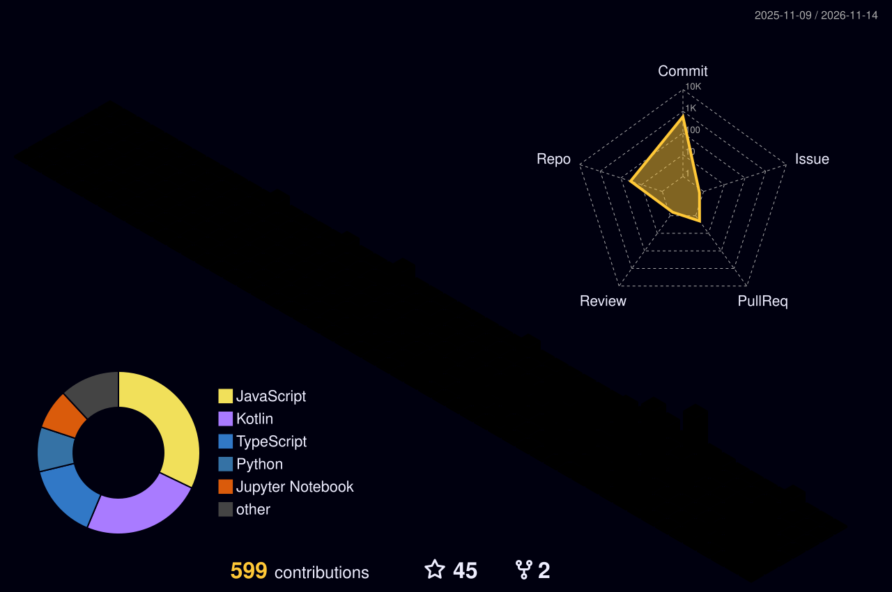
  </picture>
    
  <picture>
    <source media="(prefers-color-scheme: dark)" srcset="https://raw.githubusercontent.com/ritikthakur22/ritikthakur22/output/github-contribution-grid-snake-dark.svg?v=1" />
    <source media="(prefers-color-scheme: light)" srcset="https://raw.githubusercontent.com/ritikthakur22/ritikthakur22/output/github-contribution-grid-snake.svg?v=1" />
    
  </picture>
   
  <picture>
    <source media="(prefers-color-scheme: dark)" srcset="https://raw.githubusercontent.com/ritikthakur22/ritikthakur22/output/pacman-contribution-graph-dark.svg" />
    <source media="(prefers-color-scheme: light)" srcset="https://raw.githubusercontent.com/ritikthakur22/ritikthakur22/output/pacman-contribution-graph.svg" />
    
  </picture>

   
  
    
  <i>"Stay curious. Keep shipping."</i>
    
  <picture>
    <source media="(prefers-color-scheme: dark)" srcset="assets/footer-wave.svg" />
    <source media="(prefers-color-scheme: light)" srcset="assets/footer-wave-light.svg" />
    
  </picture>

